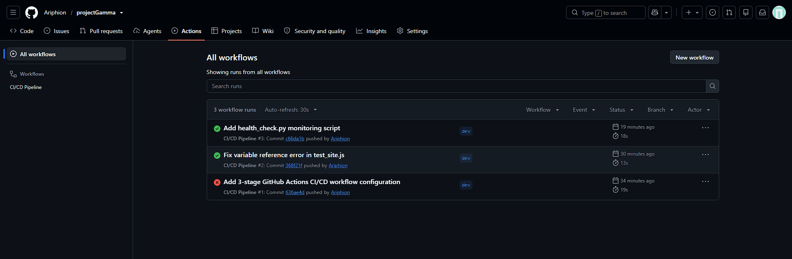

# Project Gamma - DevOps Academic Project

A responsive static website deployed via an automated CI/CD pipeline with continuous integration testing, health monitoring, and cloud hosting.

## 🚀 Project Overview
* **Version Control**: GitHub (`main` & `dev` branching strategy)
* **CI/CD Automation**: GitHub Actions (3-stage pipeline: Build, Test, Deploy)
* **Hosting Platform**: Vercel (Path B)
* **Monitoring**: Python health-check script (`health_check.py`)

---

## 🛠️ Pipeline & Architecture
Our automated workflow triggers on every push to the `main` and `dev` branches, executing three core stages:
1. **Build**: Verifies repository structure and static asset placement.
2. **Test**: Executes automated unit tests (`test_site.js`) to validate required files.
3. **Deploy**: Completes pipeline verification and syncs with hosting.

### Pipeline Status (GitHub Actions)

---

## 🧪 Testing & Health Checks
* **Unit Tests (`test_site.js`)**: Validates that all critical HTML, CSS, and script assets exist prior to deployment.
  * 

* **Health Monitoring (`health_check.py`)**: A backend script designed to check system file integrity and runtime readiness.
         
---

## 🌐 Live Deployment
The application is successfully hosted and live on Vercel.

* **Live App Preview**:
  

---

## 📊 System Status Dashboard
| Metric / Check | Visual Status | Type | Source |
| :--- | :---: | :---: | :--- |
| **CI/CD Pipeline** |  | Automated | GitHub Actions |
| **Unit Tests Suite** |  | Automated | `test_site.js` |
| **Health Monitor** |  | Script | `health_check.py` |
| **Production Hosting** |  | Cloud | Vercel Deployment |

---