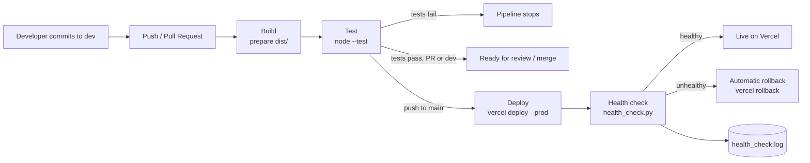
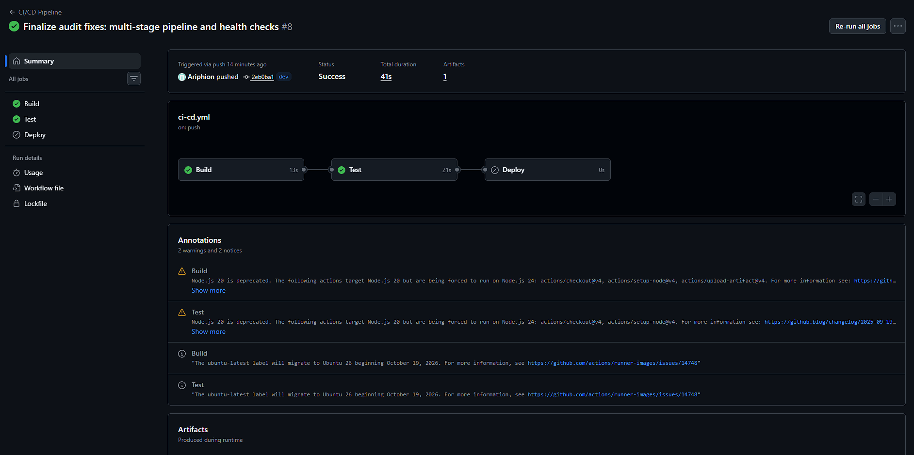
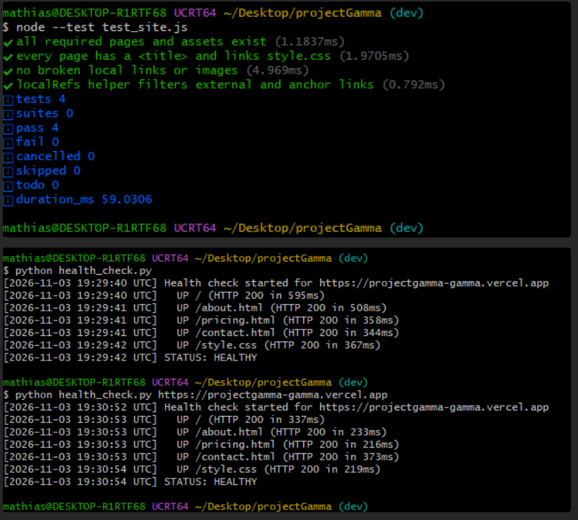

# Project Gamma – DevOps CI/CD Project

[](https://github.com/Ariphion/projectGamma/actions/workflows/ci-cd.yml)
[](https://projectgamma-gamma.vercel.app)

**Live site:** https://projectgamma-gamma.vercel.app

## 1. Project Description

**GammaTech** is a responsive multi-page static website for a computer repair and IT support business. It has five pages: Home, About, Pricing, Contact and Login. The Contact, Pricing and Login pages contain interactive forms handled in JavaScript.

The goal of this project is to apply core DevOps principles to the site: version control, automated build, automated testing, CI/CD, cloud deployment and monitoring.

### Tech Stack

| Area | Tool |
|---|---|
| Frontend | HTML5, CSS3, vanilla JavaScript |
| Version control | Git + GitHub (`main` / `dev` branches) |
| CI/CD | GitHub Actions |
| Unit tests | Node.js built-in test runner (`node:test`) |
| Hosting | Vercel (deployed through the Vercel CLI) |
| Monitoring | Python health-check script with log file |

### Repository Structure

```
projectGamma/
├── .github/workflows/ci-cd.yml   # 3-stage CI/CD pipeline
├── index.html, about.html, pricing.html, contact.html, login.html
├── style.css                     # Site styling
├── script.js                     # Form handling logic
├── assets/                       # Images and logo
├── test_site.js                  # Unit tests
├── health_check.py               # Monitoring / health check script
├── health_check.log              # Health check results
└── project_screenshots/          # Evidence screenshots for this README
```

## 2. Branching Strategy

| Branch | Purpose |
|---|---|
| `dev` | Development branch. All new work is committed here first. Every push runs Build and Test. |
| `main` | Production branch. Changes arrive only through Pull Requests from `dev`. A merge into `main` triggers deployment. |

Workflow: commit to `dev`, open a Pull Request to `main`, the pipeline validates the PR, then merge, and the pipeline deploys to production.

## 3. CI/CD Pipeline

The pipeline is defined in [`.github/workflows/ci-cd.yml`](.github/workflows/ci-cd.yml). It runs automatically on every **push** to `main` or `dev` and on every **Pull Request** into them. It has three dependent jobs. Each job starts only if the previous one succeeded.

### Stage 1: Build
- Checks out the code and sets up Node.js 20.
- Assembles the deployable site (HTML, CSS, JS, assets) into a `dist/` folder.
- Uploads `dist/` as a build artifact.

### Stage 2: Test (`needs: build`)
- Runs the unit test suite with `node --test test_site.js`.
- If any test fails, the pipeline stops and nothing is deployed.

### Stage 3: Deploy (`needs: test`, only on push to `main`)
- Installs the Vercel CLI and deploys the site to production with `vercel deploy --prod`.
- Runs `health_check.py` against the live URL.
- **Automatic rollback:** if the health check fails, the pipeline runs `vercel rollback` to restore the previous working deployment.
- Uploads `health_check.log` as a pipeline artifact.

Pushes to `dev` and Pull Requests run only Build and Test. This way, unreviewed code never reaches production.

Required GitHub secrets: `VERCEL_TOKEN`, `VERCEL_ORG_ID`, `VERCEL_PROJECT_ID`.

### Workflow Diagram



### Successful Pipeline Run


*All three jobs (Build, Test, Deploy) completed successfully.*
*Detailed view of a pipeline run in GitHub Actions.*

## 4. Unit Testing

`test_site.js` uses Node's built-in test runner and contains four tests:

| Test | What it checks |
|---|---|
| Required files exist | All pages, `style.css` and `script.js` are present |
| Page structure | Every page has a `<title>` and links `style.css` |
| No broken references | Every local link and image (`src`/`href`) points to a file that exists |
| Helper function | `localRefs()` correctly ignores external links and anchors |

Run locally:

```bash
node --test test_site.js
```


*All unit tests pass.*

## 5. Deployment (Vercel)

The site is deployed to Vercel through **Path B (cloud)**. The Deploy job of the pipeline uses the Vercel CLI. Vercel's automatic Git deployments are turned off, so the pipeline is the only route to production.


*The deployed site running at projectgamma-gamma.vercel.app.*

## 6. Monitoring & Health Check

`health_check.py` checks whether the deployed site is up and serving the correct content:

- Sends HTTP requests to `/`, `/about.html`, `/pricing.html`, `/contact.html` and `/style.css`.
- Each page must return **HTTP 200**. HTML pages must also contain the text "GammaTech".
- Retries each request up to 3 times before marking it as down.
- Appends timestamped results to **`health_check.log`**.
- Exits with code `0` (healthy) or `1` (unhealthy). In the pipeline, exit code `1` triggers the automatic rollback.

## 7. Status Dashboard (Bonus)

| Check | Live Status | Source |
|---|---|---|
| CI/CD pipeline (Build + Test + Deploy) | [](https://github.com/Ariphion/projectGamma/actions/workflows/ci-cd.yml) | GitHub Actions |
| Production website | [](https://projectgamma-gamma.vercel.app) | Live HTTP check (shields.io) |
| Health check log | [`health_check.log`](health_check.log) | `health_check.py` |